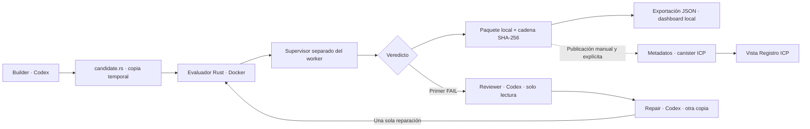

# Agent Court

**Código de agentes, evaluación independiente y evidencia inspeccionable.**
Agent Court es un MVP de hackathon para `counter-v1`: Codex genera o repara un
contador Rust, una batería independiente lo evalúa dentro de Docker y el
evaluador conserva código, resultados y una cadena de intentos con SHA-256.
El dashboard compara esos paquetes locales y consulta por separado los
metadatos registrados en un canister Rust de Internet Computer (ICP).

Builder, Reviewer y Repair ya se probaron con Codex real. La demostración
controlada conservada obtuvo **FAIL → PASS con dos evaluaciones Docker reales**.
En esa demostración Builder se omitió: el candidato inicial fue proporcionado.
Un veredicto local, un log de agentes y una publicación ICP son hechos distintos.

## Arquitectura real

| Componente | Implementación y responsabilidad |
| --- | --- |
| Frontend | React + TypeScript + Vite. Importa JSON, verifica integridad, compara A/B y muestra informes y eventos del log. Otra vista consulta misiones e intentos ICP; no publica. |
| Coordinador y evaluador | Binario Rust en `evaluator/`. Gestiona workspaces, presupuesto de intentos, Docker, supervisor independiente, persistencia, `verify` y publicación opcional. |
| Codex CLI mediante `AgentRunner` | `CodexRunner` invoca `codex` de PATH con `codex exec`. Builder/Repair editan `candidate.rs`; Reviewer analiza en solo lectura. Los runners simulados se reservan para pruebas y se identifican como tales. |
| Canister Rust ICP | `backend/`, con `ic-cdk`, Candid e `ic-stable-structures`. Registra metadatos, comprueba duplicados y predecesores, y ofrece consultas. No ejecuta candidatos ni verifica sus pruebas. |



`icp.yaml` declara `backend` y `frontend`, con recetas
`@dfinity/rust@v3.4.0` y `@dfinity/static-site@v0.3.3`. Coordinador, Codex y
Docker corren fuera de ICP; el canister registra referencias a la evidencia.

### Flujo y presupuesto

1. **Builder** genera únicamente `candidate.rs` en un workspace temporal aislado.
2. **Evaluator** evalúa ese archivo en Docker y registra el resultado real.
3. Si es **PASS**, termina indicando que Repair no fue necesario.
4. Solo si es **FAIL**, **Reviewer** recibe el código evaluado y sus errores
   reales; **Repair** recibe además el análisis y edita otra copia del candidato.
5. **Evaluator** vuelve a evaluar y conserva el segundo resultado, incluso FAIL.

El límite es **dos evaluaciones y una reparación**. ERROR o NOT_RUN detienen el
flujo sin reparación automática. Fallos de agente, persistencia o publicación
no se convierten en éxito. Lo que afirma Codex no sustituye al evaluador.

Los agentes trabajan fuera del repositorio y del almacén, sin acceso de
escritura a pruebas, evaluador o paquetes. Codex tiene 180 s por llamada,
256 KiB de salida combinada, 16 KiB de mensaje final y 384 KiB de prompt;
sus herramientas de shell están desactivadas. El candidato externo se compila
y ejecuta exclusivamente en Docker. [Detalles](evaluator/README.md#coordinador-counter-v1-etapa-5b).

## Estado del MVP

| Funcionalidad | Estado y alcance de validación |
| --- | --- |
| Builder con Codex CLI real | Implementado y validado previamente. No se le atribuye el seed de la demo. |
| Reviewer y Repair reales | Validación manual 5D: log conservado y ciclo FAIL → PASS. |
| Evaluación Docker | Batería funcional y regresiones Docker ejecutadas en 5C/5D. |
| Supervisor separado | Regresiones contra `exit(0)` y `exit(73)`; no es una defensa universal contra código adversarial. |
| Presupuesto | Dos evaluaciones y una reparación como máximo; errores y primer PASS preservados. |
| Paquetes SHA-256 y cadena | Implementados; los cuatro paquetes de la demo se verificaron nuevamente durante el cierre documental. |
| Publicador ICP local | Verificación, idempotencia y conflictos de cadena. Existe una publicación real previa de etapa 4; no se publicó nada durante este cierre. |
| Canister de metadatos | Rust, memoria estable, updates restringidos a controladores y queries públicas. |
| Dashboard | A/B, hashes, informes, agentes según log y consulta ICP. Etapa 6: 30 pruebas, compilación y lint ejecutados; un aviso en un binding generado. |
| Automatización de agentes en tests | Runners simulados o ejecutables fixture explícitos; no llaman al modelo real. |
| Certificación de ejecución / seguridad absoluta | Fuera del alcance: sin atestación de ejecución, firmas del log ni prueba general de corrección. |
| Mainnet / servicio multiusuario | Fuera del alcance; el publicador solo admite ICP local administrado en loopback. |

La etapa 7 modifica documentación. Se comprobaron versiones, ayudas de CLI,
integridad de los cuatro intentos y conservación de archivos. No se repitieron
las baterías Rust/Docker/frontend ni se generaron intentos nuevos en esta etapa.

## Demo inmediata con el historial existente

Desde la raíz, con Node 24, Rust y dependencias ya instaladas:

```bash
COURT_VIEW_DIR="$(mktemp -d /tmp/agent-court-hackathon.XXXXXX)"
node frontend/scripts/export-evidence.mjs \
  --evidence-dir .agent-court/demo-stage5d-real-0jJ6d5/evidence \
  --events .agent-court/demo-stage5d-real-0jJ6d5/orchestrate.log \
  --output "$COURT_VIEW_DIR/evidence.json"
printf 'Importa este JSON: %s\n' "$COURT_VIEW_DIR/evidence.json"
npm --prefix frontend run dev -- --mode evidence --host 127.0.0.1
```

Abre la URL de Vite, pulsa **Evidencia local** y selecciona el JSON. Se comprueba
su integridad en el navegador; no se sube. A/B seleccionan los dos últimos
intentos. Abre sus informes y el análisis de Reviewer: el fallo real conserva
`successive increments`, `left: 2`, `right: 1`; el siguiente informe PASS
conserva su resultado original. Cambian los hashes de código e informe y
coincide el de criterios.

El almacén tiene exactamente estos cuatro intentos, en cadena:

| # | attempt_id | Veredicto | Eventos en `orchestrate.log` |
| --- | --- | --- | --- |
| 1 | `attempt-1793199136090-21557-18e2b91d0e44c2bd` | PASS | Sin eventos de agentes asociados en este log. |
| 2 | `attempt-1793216555492-23379-18e2c8f4d3780e06` | PASS | Sin eventos de agentes asociados en este log. |
| 3 | `attempt-1793228085556-95322-18e2d37160e0ef6f` | FAIL | Seed proporcionado; Builder omitido; inicia Reviewer/Repair. |
| 4 | `attempt-1793228102095-95322-18e2d3753aaec93b` | PASS | Segunda evaluación posterior a Repair según el log. |

`.agent-court/` está ignorado por Git: un clon nuevo no incluye este historial.
Para mostrar los resultados existentes necesitas conservar el almacén o una
exportación verificada. Para producir tus propios resultados, usa la demo
controlada manual de abajo; no garantiza repetir el mismo código o PASS.
Conserva `.agent-court/`, `demo-stage4`, `demo-stage5a` y los originales de 5D.

## Preparar el entorno WSL

Usa WSL 2 y Ubuntu con Docker Desktop integrado. Solo el primer bloque va en
PowerShell como administrador; el resto en Bash dentro de Ubuntu.
[Instalación WSL](https://learn.microsoft.com/en-us/windows/wsl/install) e
[integración Docker/WSL](https://docs.docker.com/desktop/features/wsl/).

```powershell
wsl --install -d Ubuntu-24.04
```

Reinicia si Windows lo solicita, crea el usuario Ubuntu y prepara herramientas:

```bash
sudo apt update
sudo apt install -y build-essential curl git pkg-config libssl-dev libdbus-1-3 ca-certificates python3

# nvm: instalación inicial, solo si todavía no está disponible.
curl -fsSL https://raw.githubusercontent.com/nvm-sh/nvm/v0.40.3/install.sh | bash
source ~/.bashrc
nvm install 24
nvm use 24

# Rust: instalación inicial, solo si todavía no está disponible.
curl --proto '=https' --tlsv1.2 -sSf https://sh.rustup.rs | sh
source "$HOME/.cargo/env"
rustup component add rustfmt clippy
rustup target add wasm32-unknown-unknown

# Versiones de herramientas comprobadas para esta entrega.
npm install -g @icp-sdk/icp-cli@1.7.0 @icp-sdk/ic-wasm@0.11.1 @openai/codex@0.165.0
```

Activa **Use the WSL 2 based engine** y la integración de tu distribución en
Docker Desktop. Conserva su daemon en ejecución. El evaluador requiere Rust
1.89 o posterior; el host revisado tiene Rust/Cargo 1.99.1, Node 24.22.1 y Docker
CLI 29.9.2. La imagen del candidato utiliza Rust 1.89.0.

Para un clon nuevo (omite `git clone` si ya tienes el repositorio):

```bash
git clone https://github.com/Ang3lhack/Agent_court.git
cd Agent_court
nvm use 24
npm --prefix frontend ci
cargo fetch --manifest-path backend/Cargo.toml --locked
cargo fetch --manifest-path evaluator/Cargo.toml --locked
```

`npm ci` y `--locked` usan los lockfiles existentes. No se instalaron ni
actualizaron herramientas durante este cierre documental.

## Comprobar Docker y Codex

```bash
command -v docker codex icp ic-wasm cargo node
docker --version
docker info --format '{{.ServerVersion}}'
docker image inspect --format '{{.Id}}' rust:1.89.0-slim-bookworm
# Solo si falta la imagen, prepárala antes de evaluar:
# docker pull rust:1.89.0-slim-bookworm

codex --version
codex exec --help
codex login status
# Solo si necesitas autenticarte; sigue el flujo oficial en tu terminal:
# codex login
```

El evaluador no descarga imágenes ni sustituye Codex ausente por un fixture.
El runner requiere los flags de Codex 0.165.0, incluidos `--ephemeral`,
`--ignore-user-config` y `--ignore-rules`. El estado de autenticación no demuestra
por sí solo acceso al modelo o disponibilidad de cuota.
[Codex CLI](https://learn.chatgpt.com/docs/cli) y
[autenticación oficial](https://learn.chatgpt.com/docs/auth).

## Ejecutar una misión o repetir la demo controlada

Estos comandos son **manuales**: llaman a Codex, consumen tiempo/cuota y generan
evidencias en directorios nuevos. No se ejecutaron en esta etapa.
El flujo normal comienza con Builder:

```bash
COURT_NORMAL_DIR="$(mktemp -d /tmp/agent-court-normal.XXXXXX)"
cargo run --manifest-path evaluator/Cargo.toml --locked -- \
  --evidence-dir "$COURT_NORMAL_DIR/evidence" orchestrate counter-v1
```

Para ejercitar Reviewer/Repair desde un candidato incorrecto conocido:

```bash
COURT_DEMO_DIR="$(mktemp -d /tmp/agent-court-controlled.XXXXXX)"
COURT_DEMO_STORE="$COURT_DEMO_DIR/evidence"
sha256sum evaluator/tests/fixtures/counter-fail.rs > "$COURT_DEMO_DIR/seed.sha256"
cargo run --manifest-path evaluator/Cargo.toml --locked -- \
  --evidence-dir "$COURT_DEMO_STORE" orchestrate counter-v1 \
  --demo-seed evaluator/tests/fixtures/counter-fail.rs \
  2>&1 | tee "$COURT_DEMO_DIR/orchestrate.log"
COURT_DEMO_EXIT=${PIPESTATUS[0]}
printf 'Salida: %s; almacén: %s\n' "$COURT_DEMO_EXIT" "$COURT_DEMO_STORE"
sha256sum --check "$COURT_DEMO_DIR/seed.sha256"
```

`--demo-seed` copia los bytes originales al workspace y anuncia
**DEMO CONTROLADA — candidato inicial proporcionado** y
`BUILDER OMITIDO (--demo-seed)`. El archivo original permanece intacto.
Solo un FAIL real activa Reviewer/Repair. El segundo resultado se conserva
aunque siga fallando; un primer PASS no implica reparación. Este modo rechaza
`--publish` con salida 64 antes de evaluar. La publicación posterior exige
el publicador independiente y la comprobación manual de cadena.

### Veredictos y salidas

| Veredicto | Significado | Salida de `evaluate-file` / `orchestrate` |
| --- | --- | --- |
| PASS | La batería independiente terminó correctamente. No es una prueba general de corrección. | 0 |
| FAIL | Compilación/API incorrecta, aserción fallida, terminación prematura o límite del candidato. | 1 |
| ERROR | Infraestructura, toolchain, estado o limpieza Docker fallidos. | 2 |
| NOT_RUN | Evaluación omitida explícitamente; no equivale a PASS. | 3 |

Los fallos de agente, lectura, persistencia o publicación devuelven 2; pueden
ocurrir sin nuevo informe. Uso incorrecto devuelve 64. `orchestrate` intenta
evaluar siempre; NOT_RUN se prueba con un evaluador inyectado. La CLI permite
omitir la ejecución con `evaluate-file RUTA --no-run`.

El modo histórico **sin subcomando** ejecuta el fixture confiable en el host y
añade un intento al almacén seleccionado. Para la demo de agentes usa
`orchestrate`. Ningún candidato externo se ejecuta en el host.

## Evidencias locales, verificación e ICP

Localmente se guardan `evidence.jsonl` y, por intento, `criteria.txt`, `artifact.rs`,
`report-payload.json`, `report.json` y `manifest.json`. El payload y su SHA-256
incluyen resultados, fecha y aislamiento; el manifiesto conserva además el
checksum del informe completo. Cada intento enlaza el anterior de la misma
misión con `previous_attempt_id`. Paquetes nuevos: v1; informes: v2.
Un registro legacy sin archivos no se reconstruye ni es publicable.

Los mensajes de agentes no se archivan automáticamente en esos paquetes.
`orchestrate.log` es una captura local adicional no firmada. El dashboard solo
asocia eventos presentes y compatibles con los intentos; no infiere agentes
ausentes. El hash del log exportado comprueba esa copia, no su autoría.

Para verificar un intento existente sin ejecutar código, agentes o ICP:

```bash
COURT_EXISTING_STORE=.agent-court/demo-stage5d-real-0jJ6d5/evidence
cargo run --manifest-path evaluator/Cargo.toml --locked -- \
  --evidence-dir "$COURT_EXISTING_STORE" \
  verify attempt-1793228085556-95322-18e2d37160e0ef6f
cargo run --manifest-path evaluator/Cargo.toml --locked -- \
  --evidence-dir "$COURT_EXISTING_STORE" \
  verify attempt-1793228102095-95322-18e2d3753aaec93b
```

Repite `verify` con los otros IDs para comprobar los cuatro paquetes. Para una
ejecución nueva usa su almacén y cada ID de `VERDICT`. `verify` devuelve 0 por
integridad comprobada, 2 por error y 3 para legacy. Comprueba el paquete y su
enlace en el índice; no verifica recursivamente todos los paquetes anteriores.
Verificar un FAIL no lo transforma en PASS.

ICP recibe ocho campos originales: `mission_id`, `attempt_id`,
`previous_attempt_id`, `criteria_hash`, `artifact_hash`, `report_hash`, `verdict`
y `timestamp_unix_ms`. Añade `registered_at` y `registered_by` del registro.
La misión conserva ID, nombre, descripción, criterios y datos de registro.
**Código, informes completos, log y mensajes no se suben a ICP.**

### Publicar un intento ya verificado en ICP local

Es una operación manual y explícita, fuera de la demo de dos minutos. Requiere
red/backend existentes, una misión compatible y una identidad **ya controladora**.
El publicador no crea misiones, despliega canisters ni cambia identidades o
controladores. Un FAIL íntegro se puede publicar conservando su veredicto.

Primero consulta el entorno y la cadena remota, sin escribir:

```bash
icp network status --environment local --json
icp canister status backend --environment local --id-only
icp canister call backend get_mission '("counter-v1")' \
  --environment local --identity anonymous --query --output candid --candid backend/backend.did
icp canister call backend list_attempts '("counter-v1", null, 100 : nat16)' \
  --environment local --identity anonymous --query --output candid --candid backend/backend.did
```

Si hay 100 entradas, continúa con el último `attempt_id` de esa página como
`opt text` hasta terminar. Reconstruye la punta por enlaces: el orden por fecha
no basta. Comprueba misión/criterios y que el predecesor local sea la punta
remota, o que ese intento ya esté registrado idéntico. No supongas que 5D está alineado.

Solo después de esa revisión, selecciona un intento ya existente:

```bash
read -r -p 'Almacén revisado y alineado con ICP local: ' COURT_PUBLISH_STORE
read -r -p 'attempt_id existente que se publicará: ' COURT_PUBLISH_ID
read -r -p 'Nombre de identidad ya controladora: ' COURT_PUBLISH_IDENTITY
cargo run --manifest-path evaluator/Cargo.toml --locked -- \
  --evidence-dir "$COURT_PUBLISH_STORE" verify "$COURT_PUBLISH_ID" && \
cargo run --manifest-path evaluator/Cargo.toml --locked -- \
  --evidence-dir "$COURT_PUBLISH_STORE" publish "$COURT_PUBLISH_ID" \
  --identity "$COURT_PUBLISH_IDENTITY"
```

`publish` vuelve a verificar, comprueba la cadena remota completa y confirma con
`get_attempt`. Un duplicado idéntico es idempotente. Un conflicto detiene el
proceso sin alterar predecesores, hashes o paquetes. Ante una respuesta incierta
reconcilia el **mismo ID**; no generes otro intento. Consulta un ID concreto:

```bash
icp canister call backend get_attempt "(\"$COURT_PUBLISH_ID\")" \
  --environment local --identity anonymous --query --output candid --candid backend/backend.did
```

`demo-stage4/` conserva el intento publicado realmente en una etapa previa;
`demo-stage5a/` contiene FAIL/PASS locales que no se publicaron entonces. La demo
5D anuncia `PUBLICATION LOCAL`: no implica que sus cuatro intentos estén
registrados en la red actual. La comprobación remota sigue siendo necesaria.

## Dashboard y exportación

La demo inmediata exporta el historial real sin cambiarlo. Para otro almacén
usa el mismo exportador con `--evidence-dir RUTA`, un `--output` nuevo fuera
del almacén y de `.agent-court/`, y opcionalmente `--events LOG`. Reutiliza
`verify` de Rust y valida de nuevo los bytes capturados. La importación exige
manifiestos, hashes, informes y cadena completos.

Límites: 8 MiB, 100 intentos, 1 MiB por archivo/log, índice de 2 MiB y fechas
enteras seguras en JavaScript. No pongas el JSON en `public/`: contiene código
y diagnósticos. En WSL puedes elegir `/tmp` desde
`\\wsl.localhost\Ubuntu-24.04\tmp` (ajusta tu distribución).

Para **Registro ICP**, con la red y el backend ya disponibles:

```bash
ICP_ENVIRONMENT=local npm --prefix frontend run dev -- --host 127.0.0.1
```

Vite obtiene ID y root key de la red y configura cookie `ic_env` y proxy.
Selecciona Registro ICP y una misión. La vista local no necesita ICP; el modo
ICP no requiere un nuevo deploy. Un JSON no queda certificado por aparecer
junto a consultas ICP. [Detalles de importación y pruebas](frontend/README.md).

Para compilar sin desplegar: `icp build backend --environment local` y
`npm --prefix frontend run build`. En un entorno local **nuevo y desechable**
sin canisters, el arranque/despliegue inicial es una decisión manual aparte:
`icp network start --environment local -d` y después
`icp deploy --environment local --identity NOMBRE_YA_EXISTENTE`.
No apliques esa secuencia al entorno que conserva publicaciones: la guía oficial
describe que stop/start descarta el estado local. Este cierre no inicia ni redespliega ICP.

## Comandos de pruebas y compilación

Comandos reproducibles para el operador. Las suites ordinarias usan almacenes
temporales y agentes simulados; no les pases rutas de historiales reales.

```bash
cargo test --manifest-path backend/Cargo.toml --locked
cargo test --manifest-path evaluator/Cargo.toml --locked
cargo fmt --manifest-path evaluator/Cargo.toml -- --check
cargo check --manifest-path evaluator/Cargo.toml --locked
cargo clippy --manifest-path evaluator/Cargo.toml --all-targets --locked -- -D warnings
npm --prefix frontend test
npm --prefix frontend run build
npm --prefix frontend run lint
```

Integraciones Docker optativas, con daemon e imagen preparados:

```bash
cargo test --manifest-path evaluator/Cargo.toml --locked docker_ -- --ignored --nocapture
```

Cubren archivos correctos/incorrectos, compilación, aislamiento, límites,
terminaciones prematuras y flujos PASS, FAIL → PASS y FAIL → FAIL. Usan Docker
real y runners simulados o Codex falso explícito, sin modelo ni ICP. No ejecutes
indiscriminadamente todas las pruebas ignoradas: también existe una integración
de queries ICP con requisitos propios.

## Límites de confianza y riesgos restantes

- **Docker comparte kernel.** Usuario no privilegiado, raíz/entrada en lectura,
  red desactivada, capacidades eliminadas y límites reducen exposición. No es
  una VM ni garantiza contención absoluta. El contenedor tiene 30 s, pruebas de
  5 s, 512 MiB y 64 KiB de salida; no recibe repositorio, evidencias, credenciales
  ni socket Docker.
- **Supervisor separado.** Evita que `exit(0)`/`exit(73)` del worker cuente como
  completar la batería. Ambos procesos comparten contenedor y UID; el candidato
  puede intentar falsificar el protocolo o interferir. No hay autenticación
  frente a código arbitrario en el worker. La batería solo cubre `counter-v1`.
- **SHA-256 comprueba coherencia.** No prueba autoría, ejecución auténtica,
  corrección general ni fecha fiable. Quien controla todos los archivos puede
  reemplazarlos y recalcular hashes. No hay firmas ni prueba absoluta del
  historial completo; el log local tampoco está autenticado.
- **Append-only por interfaz pública.** El backend no ofrece edición ni borrado
  de entradas. Un controlador puede actualizar/reinstalar el canister o cambiar
  controladores; no es absolutamente inmutable. Los archivos locales también
  son modificables por su propietario: el programa conserva el prefijo histórico
  y coordina un escritor, sin impedir editores externos.
- **Confianza en controladores.** El backend valida autorización, campos y
  cadena, pero acepta el veredicto declarado; no recalcula archivos ni ejecuta
  Docker. Protege esas identidades. Si el principal anónimo fuera controlador,
  ese acceso estaría compartido por todos.
- **ICP local y queries.** La memoria estable admite upgrades compatibles, no
  reinstalaciones o pérdida de red local. Las queries no aportan certificación
  de aplicación de los informes. Capacidad MVP: 100 misiones, 10.000 intentos y
  páginas de hasta 100; la paginación actual no está diseñada para gran escala.
- **Disponibilidad.** Codex puede fallar, agotar cuota o no reparar. Docker y
  PocketIC dependen de la máquina de presentación. La demo preparada conserva
  un recorrido local sin nuevas llamadas al modelo ni dependencia del reloj ICP.

## Resolución de problemas

| Síntoma | Comprobación y acción |
| --- | --- |
| Docker no disponible / permiso denegado | Ejecuta `docker info`. Abre Docker Desktop, revisa WSL Integration y acceso al daemon. No ejecutes candidatos en el host como alternativa. ERROR no es FAIL del código ni activa Repair. |
| Imagen ausente | Ejecuta manualmente `docker pull rust:1.89.0-slim-bookworm`; el evaluador no descarga solo. |
| Codex ausente o sin autenticar | Comprueba PATH, versión, `codex exec --help` y `codex login status`. Si procede, `codex login` en tu terminal. No compartas tokens; autenticación no garantiza cuota. |
| Puerto Vite ocupado | Usa `npm --prefix frontend run dev -- --mode evidence --host 127.0.0.1 --port 5174 --strictPort`. En modo ICP omite `--mode evidence`. Abre la URL impresa y no cierres procesos ajenos. |
| JSON alterado, incompleto o incompatible | Debe rechazarse y retirarse el dato anterior. Reexporta desde originales verificados a otro archivo nuevo. No edites hashes/predecesores para ocultar el fallo. SHA-256 del navegador requiere HTTPS o localhost. |
| Conexión ICP / cookie ausente | Comprueba `icp network status --environment local --json` e ID con `icp canister status backend --environment local --id-only`. Usa Vite en modo ICP para esa vista; evidence omite cookie/proxy. Reiniciar Vite relee configuración sin reiniciar ICP. |
| `Unauthorized`, misión ausente o `ChainConflict` | Usa una identidad ya controladora, comprueba misión y cadena remota completa. Detente ante discrepancias; no cambies identidades, contratos o evidencias para forzar la publicación. |

### Desfase de reloj / PocketIC

`Invalid request expiry`, `ingress_expiry` o certificados fuera de tiempo indican
un problema temporal de consulta, no un defecto del contador. Compara el reloj
Windows/WSL con UTC y revisa la red indicada por ICP CLI:

```bash
date -u
icp network status --environment local --json
```

Corrige la sincronización del sistema con las herramientas de Windows/WSL.
Si el host está correcto y PocketIC sigue desfasado, conserva el error completo
y revisa su proceso antes de actuar. La ayuda de `icp network` 1.7.0 no ofrece
un comando para fijar su reloj: no hay arreglo automático documentado aquí.
El dashboard detiene consultas por reloj hasta recargar tras resolverlo.
No cambies timestamps archivados.

**No detengas/recrees la red ni borres `.icp/` para salvar la presentación:**
la guía oficial advierte que stop/start descarta estado. Continúa con Evidencia
local y explica la consulta ICP no disponible; no muestres un éxito inventado.

## Guion de demostración · dos minutos

Prepara antes el JSON exportado/verificado y Vite abierto con los últimos
intentos en A/B. Si mostrarás ICP, comprueba su conexión antes; no lances modelos
ni publiques durante el cronómetro.

| Tiempo | Acción y narración |
| --- | --- |
| 0:00–0:20 | «Agent Court separa generar código de evaluarlo. Codex propone; Rust comprueba en Docker y conserva evidencia». Señala los cuatro componentes. |
| 0:20–0:40 | Importa el JSON y muestra cuatro intentos. «Es evidencia local verificada por hashes; no afirmamos certificación ICP». |
| 0:40–1:00 | Compara los últimos: FAIL → PASS. Abre el FAIL: incrementó 2 en lugar de 1. Señala hashes de código/informe distintos y criterios iguales. |
| 1:00–1:25 | Abre agentes y análisis. «El candidato inicial fue proporcionado: Builder se omitió. Reviewer y Repair usaron Codex real según el log, seguido de otra evaluación Docker». |
| 1:25–1:45 | Muestra el PASS y el límite de una reparación/dos evaluaciones. Si ICP está disponible, muestra solo metadatos realmente consultados, aunque pertenezcan a otro intento. |
| 1:45–2:00 | «SHA-256 comprueba bytes, no corrección universal. Docker/supervisor mitigan ataques conocidos; ICP registra metadatos bajo control de sus controladores». Si ICP falla, continúa en local y dilo. |

## Procedencia de comandos y documentación

| Comandos / afirmaciones | Fuente contrastada |
| --- | --- |
| `orchestrate`, `--demo-seed`, `verify`, `publish` y salidas | `evaluator/src/cli.rs`, `main.rs`, `orchestrator.rs`, `runner.rs`, `candidate.rs`, `evidence.rs`, `publisher.rs` y ayuda real del binario. |
| Exportación, tests y Vite | `frontend/scripts/export-evidence.mjs`, `package.json`, `vite.config.ts`, validador local y pruebas existentes. |
| ICP CLI 1.7.0 y flags | Ayuda instalada de `network`, `build`, `deploy`, `canister call/status`, `identity principal`; [índice oficial](https://cli.internetcomputer.org/llms.txt), [instalación](https://cli.internetcomputer.org/1.7/guides/installation.md) y [red local](https://cli.internetcomputer.org/1.7/guides/local-development.md). |
| Rust canister / persistencia | [Rust CDK](https://docs.internetcomputer.org/languages/rust/) y [estructuras estables](https://docs.internetcomputer.org/languages/rust/stable-structures/), contrastados con backend, Cargo.toml y Candid existentes. |
| Skills ICP on-demand | [Instrucciones](https://skills.internetcomputer.org/llms.txt), [índice](https://skills.internetcomputer.org/.well-known/skills/index.json), [icp-cli](https://skills.internetcomputer.org/.well-known/skills/icp-cli/SKILL.md), [canister-security](https://skills.internetcomputer.org/.well-known/skills/canister-security/SKILL.md) y [stable-memory](https://skills.internetcomputer.org/.well-known/skills/stable-memory/SKILL.md). |
| Codex CLI 0.165.0 y login | Versión/ayudas instaladas, [OpenAI Docs: CLI](https://learn.chatgpt.com/docs/cli) y [autenticación](https://learn.chatgpt.com/docs/auth). |
| WSL, nvm, Rust y Docker | [Microsoft WSL](https://learn.microsoft.com/en-us/windows/wsl/install), [nvm v0.40.3](https://github.com/nvm-sh/nvm/tree/v0.40.3#installing-and-updating), [rustup](https://rust-lang.org/tools/install/) y [Docker WSL](https://docs.docker.com/desktop/features/wsl/). |

Documentación específica:

- [Backend: registro Rust y modelo de controladores](backend/README.md).
- [Evaluador: aislamiento, evidencias, coordinación y publicador](evaluator/README.md).
- [Frontend: importación local, comparación y consultas ICP](frontend/README.md).

El MVP está preparado para una presentación local reproducible. Un servicio
público necesita revisión adicional de ejecución adversarial, atestación,
certificación, controladores, disponibilidad y escala.
