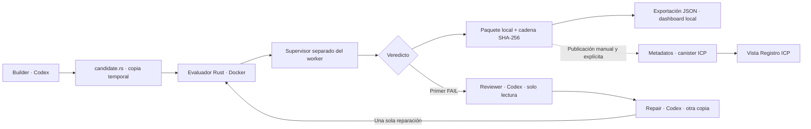
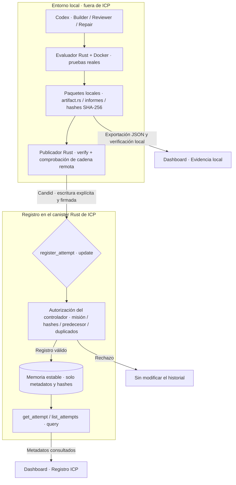

# Agent Court: Codex Evidence Engine

**Sistema de coordinación de agentes de programación, evaluación independiente de código y registro verificable de evidencias.**

Agent Court es un prototipo funcional (*Minimum Viable Product*, MVP) desarrollado para un hackathon. Su propósito consiste en separar la **generación de software mediante agentes de inteligencia artificial** de la **comprobación independiente de su comportamiento**, y conservar información suficiente para analizar y comparar los resultados obtenidos en cada intento.

La implementación actual se centra deliberadamente en una misión reproducible, denominada `counter-v1`: construir en **Rust** un contador con operaciones de incremento, consulta y reinicio. El proyecto utiliza **Codex CLI** para generar o reparar código, **Rust** para coordinar los agentes y determinar veredictos, **Docker** para ejecutar las pruebas en un entorno restringido y un **canister Rust de Internet Computer Protocol (ICP)** para registrar metadatos de los intentos. La interfaz, desarrollada con **React, TypeScript y Vite**, permite inspeccionar los resultados locales y consultar el registro ICP.

> **Alcance:** Agent Court no pretende demostrar formalmente que cualquier programa es correcto. Sus veredictos indican el resultado de una batería de pruebas definida para `counter-v1`. La integridad de los archivos locales, el historial de agentes y el registro ICP representan tres niveles de información diferentes: ninguno debe presentarse como una certificación criptográfica de la ejecución.

**Repositorio:** https://github.com/Ang3lhack/Agent_court

## Índice

1. [Planteamiento y objetivos](#1-planteamiento-y-objetivos)
2. [Arquitectura del sistema](#2-arquitectura-del-sistema)
3. [Funcionamiento de la misión y los agentes](#3-funcionamiento-de-la-misión-y-los-agentes)
4. [Evaluación independiente y seguridad de ejecución](#4-evaluación-independiente-y-seguridad-de-ejecución)
5. [Modelo de evidencias y verificación](#5-modelo-de-evidencias-y-verificación)
6. [Registro descentralizado con ICP](#6-registro-descentralizado-con-icp)
7. [Interfaz de usuario](#7-interfaz-de-usuario)
8. [Tecnologías, programas y dependencias](#8-tecnologías-programas-y-dependencias)
9. [Organización del repositorio](#9-organización-del-repositorio)
10. [Tutorial de instalación desde cero](#10-tutorial-de-instalación-desde-cero)
11. [Tutorial de ejecución y uso](#11-tutorial-de-ejecución-y-uso)
12. [Pruebas y comprobación del proyecto](#12-pruebas-y-comprobación-del-proyecto)
13. [Resolución de problemas](#13-resolución-de-problemas)
14. [Estado actual, limitaciones y trabajo futuro](#14-estado-actual-limitaciones-y-trabajo-futuro)
15. [Referencias técnicas](#15-referencias-técnicas)

---

## 1. Planteamiento y objetivos

### 1.1. Problema abordado

Los agentes de programación pueden producir código, corregir errores y comunicar que una tarea ha sido terminada. Sin embargo, la afirmación de un agente no constituye por sí misma una comprobación independiente. En particular, la generación y la evaluación pueden compartir supuestos incorrectos, las pruebas pueden ser insuficientes y los resultados pueden perder su relación con los archivos exactos que se evaluaron.

Agent Court propone una separación explícita de responsabilidades: los agentes **proponen modificaciones**; un evaluador externo **ejecuta criterios predefinidos**; un almacén local **conserva artefactos e informes**; y un registro en ICP **publica metadatos asociados a cada intento**, cuando el operador solicita expresamente esa operación.

### 1.2. Objetivo general

Diseñar e implementar una plataforma mínima de evaluación de código producido o modificado por agentes de inteligencia artificial que permita reproducir pruebas, registrar sus resultados, verificar la consistencia de las evidencias y consultar un historial de intentos.

### 1.3. Objetivos específicos

- Coordinar los roles **Builder**, **Reviewer** y **Repair** sin depender de modelos de inteligencia artificial distintos.
- Ejecutar pruebas funcionales sobre código Rust en un ambiente separado del coordinador.
- Distinguir de manera explícita los veredictos `PASS`, `FAIL`, `ERROR` y `NOT_RUN`.
- Conservar los bytes originales del candidato evaluado, los criterios y los reportes generados.
- Calcular hashes SHA-256 y mantener referencias de predecesores entre intentos.
- Registrar en un canister ICP metadatos consultables, sin enviar código fuente ni informes completos.
- Presentar y comparar evidencias en un dashboard, diferenciando los datos locales de los obtenidos desde ICP.

### 1.4. Alcance funcional

El MVP implementa una única misión, `counter-v1`, y limita cada ejecución coordinada a **dos evaluaciones y una reparación**. Esta restricción reduce el tiempo de ejecución, las dependencias y la complejidad del flujo; no constituye una limitación inherente a Rust, Codex o ICP.

El sistema está pensado para una demostración y experimentación **local**. No implementa autenticación para usuarios finales, ejecución multiusuario como servicio público ni publicación automática en la red principal de Internet Computer.

### 1.5. Justificación e innovación: de los resultados de IA a evidencias contrastables

#### Justificación del proyecto

La incorporación de agentes de inteligencia artificial al desarrollo de software permite generar y modificar programas con rapidez, pero también plantea una dificultad de confianza: **¿cómo distinguir una afirmación de éxito realizada por un agente de un resultado comprobado por un mecanismo independiente?** El problema no termina al ejecutar las pruebas. Si el código evaluado, el informe y los criterios no quedan vinculados de forma verificable, resulta difícil reconstruir qué versión produjo determinado resultado, identificar una reparación o detectar modificaciones posteriores.

Agent Court aborda esta necesidad mediante un enfoque de **evaluación independiente, trazabilidad criptográfica y registro externo de metadatos**. Su aportación no consiste en utilizar IA para escribir un contador —una tarea deliberadamente sencilla—, sino en construir un proceso inspeccionable que conserva tanto los **intentos fallidos** como los exitosos. Este diseño resulta pertinente para escenarios de desarrollo asistido por IA, revisión técnica, auditoría de cambios y comparación reproducible de candidatos.

#### Conceptos fundamentales

| Tecnología o concepto | ¿Qué es? | ¿Qué aporta a Agent Court? |
| --- | --- | --- |
| **Blockchain o cadena de bloques** | Tecnología de registro distribuido en la que una red aplica reglas compartidas para acordar y conservar su estado. Su diseño dificulta que un participante aislado modifique unilateralmente el registro consensuado. | Introduce un plano de registro diferente del equipo donde trabajan Codex y Docker. El proyecto no implementa su propia blockchain: utiliza la infraestructura de ICP. |
| **Internet Computer Protocol (ICP)** | Plataforma blockchain que ejecuta aplicaciones mediante una red de subredes y nodos, con consenso y estado replicado. Puede alojar lógica de aplicación y datos, no solamente transferencias de tokens. | Proporciona el entorno donde puede ejecutarse el canister encargado del registro de misiones e intentos. En el MVP se utiliza una **réplica local** para desarrollo; esta no equivale al despliegue en la red pública distribuida. |
| **Canister** | Unidad de software de ICP que combina código WebAssembly y estado persistente. Se comunica a través de mensajes y puede exponer métodos de actualización (*update*) y consulta (*query*). | Implementa en Rust las reglas del registro: autorización de escrituras, validación de identificadores, control de duplicados y continuidad de predecesores. |
| **Hash SHA-256** | Función criptográfica que transforma una secuencia de bytes en una huella de **256 bits**, representada normalmente mediante 64 caracteres hexadecimales. Cambiar los bytes suele producir una huella diferente. | Relaciona el código evaluado, los criterios y el informe con sus registros exactos. Permite comprobar discrepancias sin subir a ICP el contenido completo de esos archivos. |
| **Cadena de intentos** | Secuencia de registros en la que cada intento identifica su predecesor mediante `previous_attempt_id`. En Agent Court es una cadena **lógica de evidencias**, distinta de la estructura interna de bloques de ICP. | Permite reconstruir el orden de evaluaciones y conservar explícitamente el recorrido **FAIL → reparación → PASS**, sin sustituir el intento fallido por el exitoso. |

#### Propuesta de valor diferencial

La innovación de Agent Court reside en **combinar capacidades que, por separado, no resuelven el problema completo**:

1. **Los agentes producen propuestas, no veredictos.** Builder y Repair modifican el candidato; Reviewer analiza defectos; un evaluador Rust separado decide el resultado a partir de pruebas ejecutadas dentro de Docker.
2. **La evidencia corresponde a bytes concretos.** `artifact_hash`, `criteria_hash` y `report_hash` identifican el código, los criterios y el informe conservados; la cadena de predecesores permite analizar su evolución.
3. **Los intentos fallidos son información valiosa.** A diferencia de una demostración que enseña solo el resultado final, Agent Court conserva el error inicial y la reparación posterior, aportando contexto al proceso de desarrollo asistido por IA.
4. **ICP ofrece un registro externo al entorno del agente.** El canister puede almacenar y exponer los metadatos mediante reglas programadas, reduciendo la dependencia exclusiva de una base de datos privada del operador. Las consultas permiten contrastar identificadores y hashes con los paquetes locales.
5. **La arquitectura evita publicar datos innecesarios.** Código fuente, diagnósticos completos y logs permanecen fuera de ICP. El registro on-chain contiene referencias compactas; el dashboard muestra claramente qué datos son locales y cuáles provienen del canister.

**Diferencial frente a una implementación Web 2.0 convencional:** una aplicación tradicional podría guardar todos los resultados en una base de datos controlada por el servidor que también ejecuta la evaluación. Agent Court **separa la generación, la comprobación, la conservación del artefacto y el registro de sus metadatos**. Esa separación habilita un modelo de auditoría más transparente y, en un despliegue público de ICP con gobernanza adecuada, reduce la necesidad de confiar exclusivamente en un administrador de base de datos. Las bases de datos Web 2.0 también pueden incorporar auditorías, firmas y controles de integridad; la diferencia es la **infraestructura y gobernanza del registro**, no una supuesta imposibilidad técnica de conseguir trazabilidad fuera de blockchain.

**Alcance real de la garantía:** el canister no inspecciona ni ejecuta el código candidato: registra los hashes y veredictos proporcionados por una identidad autorizada. Los hashes detectan cambios de bytes, pero **no prueban por sí solos autoría, corrección del programa o autenticidad de la ejecución**. Además, mientras existan controladores con privilegios administrativos, no corresponde calificar el canister como absolutamente inmutable. La réplica local de este MVP demuestra la integración funcional con ICP, **no** las garantías de descentralización de un despliegue en mainnet.

Fuentes de referencia: [arquitectura de aplicaciones ICP](https://docs.internetcomputer.org/getting-started/app-architecture/), [canisters y controladores](https://docs.internetcomputer.org/concepts/canisters/), [modelo de red y subredes](https://docs.internetcomputer.org/concepts/network-overview/) y [datos certificados y límites de las consultas](https://docs.internetcomputer.org/concepts/certified-data/).

## 2. Arquitectura del sistema

### 2.1. Componentes principales

| Componente | Tecnología | Responsabilidad |
| --- | --- | --- |
| Frontend | React, TypeScript, Vite y SDK ICP | Visualizar misiones, intentos, veredictos, reportes, hashes, comparaciones y eventos de agentes. |
| Coordinador | Rust | Organizar los roles, preparar directorios temporales y controlar el presupuesto de evaluaciones. |
| Adaptador de agentes | Rust y Codex CLI | Ejecutar Codex como proceso hijo, asignar instrucciones según el rol y recoger estados, errores y mensajes. |
| Evaluador independiente | Rust, shell, compilador Rust y Docker | Compilar y comprobar el candidato fuera del proceso principal, aplicando límites de ejecución. |
| Almacén de evidencias | Sistema de archivos local, JSON/JSONL y SHA-256 | Preservar código, criterios, informes, manifiestos y referencias entre intentos. |
| Registro de evidencias | Canister Rust en ICP, Candid y memoria estable | Almacenar metadatos de misiones e intentos y ofrecer operaciones de registro y consulta. |

El coordinador, Codex y Docker **no se ejecutan dentro del canister**. ICP participa en el registro y la consulta de metadatos, no en la ejecución del código evaluado.

### 2.2. Diagrama de arquitectura



### 2.3. Separación de responsabilidades

La arquitectura evita que el mismo componente controle simultáneamente la generación del candidato, la definición de los criterios y la emisión del veredicto. El agente no modifica la batería del evaluador ni el historial archivado. El ejecutable Rust conserva la responsabilidad de leer los resultados reales del contenedor, construir los informes y determinar si corresponde continuar con una reparación.

El proyecto ICP se configura mediante `icp.yaml` y los archivos `backend/canister.yaml` y `frontend/canister.yaml`. Define un canister de aplicación Rust (`backend`) y un canister de distribución del sitio estático (`frontend`); **no agrega un canister para ejecutar código**.

## 3. Funcionamiento de la misión y los agentes

### 3.1. Contrato de `counter-v1`

La misión solicita implementar un contador con el siguiente comportamiento observable:

- Al crear una instancia, su valor inicial es cero.
- `increment()` aumenta el valor en una unidad.
- `value()` consulta el valor actual sin modificarlo.
- `reset()` establece nuevamente el valor en cero.
- Las instancias de `Counter` mantienen estados independientes.

La interfaz Rust esperada es equivalente a:

```rust
#[derive(Default)]
pub struct Counter(u64);

impl Counter {
    pub fn increment(&mut self) {
        self.0 += 1;
    }

    pub fn value(&self) -> u64 {
        self.0
    }

    pub fn reset(&mut self) {
        self.0 = 0;
    }
}
```

Este fragmento es **un ejemplo de implementación correcta**, no un código de respaldo que el evaluador agregue automáticamente cuando el candidato falla.

### 3.2. Roles

**Builder.** Recibe el contrato de la misión y genera `candidate.rs` en un directorio temporal. Es el responsable de elaborar la primera versión durante una ejecución normal.

**Evaluator.** Compila y prueba los bytes exactos de `candidate.rs` en Docker. Calcula un veredicto sin aceptar como evidencia una afirmación del agente o una cadena de texto impresa por el candidato.

**Reviewer.** Se invoca únicamente después del primer `FAIL`. Examina el archivo que realmente fue evaluado y los errores registrados. Funciona en modo de solo lectura y produce un diagnóstico con indicaciones para la reparación.

**Repair.** Recibe el diagnóstico de Reviewer, los errores de las pruebas y una nueva copia del candidato. Modifica el código y permite efectuar una segunda evaluación independiente.

Los tres agentes de programación emplean el mismo adaptador `AgentRunner` y pueden utilizar la misma instalación de Codex CLI con instrucciones diferentes. **Evaluator no es un agente generativo:** es código de evaluación separado.

### 3.3. Secuencia de ejecución

1. Builder crea el candidato en el flujo ordinario; en una demostración controlada puede proporcionarse un archivo inicial.
2. Evaluator ejecuta la primera batería y guarda un intento.
3. Ante `PASS`, termina el procedimiento sin llamar a Reviewer ni Repair.
4. Ante el primer `FAIL`, Reviewer analiza las fallas y Repair modifica una copia del candidato.
5. Evaluator ejecuta una segunda batería, archiva el veredicto real y termina, sea `PASS`, `FAIL` o `ERROR`.
6. Ante `ERROR` o `NOT_RUN`, no se genera automáticamente una reparación.

El presupuesto es fijo: **máximo dos evaluaciones y una reparación**. Un error de agente o de persistencia no se transforma en `PASS`.

### 3.4. Ejecución mediante Codex CLI

El módulo `evaluator/src/runner.rs` define la interfaz `AgentRunner` y su implementación `CodexRunner`. El ejecutor inicia `codex exec` como proceso hijo y conserva el estado de terminación y el mensaje final. Para evitar operaciones fuera del propósito de la misión, se aplican restricciones sobre el directorio de trabajo, las herramientas habilitadas, la duración y la salida.

| Recurso | Límite implementado |
| --- | --- |
| Duración máxima de una llamada a Codex | 180 segundos |
| Salida combinada del proceso | 256 KiB |
| Mensaje final del agente | 16 KiB |
| Tamaño del prompt | 384 KiB |
| Archivos que el agente puede entregar | Únicamente `candidate.rs` dentro de su workspace |
| Modo de Reviewer | Solo lectura |

El uso de una sandbox de herramientas reduce el riesgo de modificaciones no previstas; no representa una garantía absoluta frente a agentes o software malicioso. Los archivos históricos permanecen fuera del directorio temporal del agente.

### 3.5. Demostración controlada (`--demo-seed`)

Esta modalidad comienza con un archivo defectuoso aportado explícitamente por el operador. **No ejecuta Builder** y registra esa procedencia. Si la primera evaluación confirma `FAIL`, ejecuta Reviewer y Repair mediante el adaptador configurado y vuelve a evaluar. No fuerza un resultado aprobado y **no permite combinarse con `--publish`**.

Esta opción es útil para observar el ciclo de revisión sin depender de que Builder cometa espontáneamente un error.

## 4. Evaluación independiente y seguridad de ejecución

### 4.1. Batería funcional

El evaluador comprueba el valor inicial, cien incrementos sucesivos, consultas repetidas, reinicio, idempotencia del reinicio, incremento posterior al reinicio e independencia de las instancias. Las pruebas están definidas por el evaluador y no por el candidato.

El código aportado se compila y ejecuta **dentro de una imagen Docker de Rust**, en un espacio de trabajo independiente. Los archivos del repositorio, las credenciales, el almacén de evidencias y el socket Docker no se montan en el contenedor.

### 4.2. Supervisor y proceso de trabajo

La batería consta de un **supervisor** (`suite.rs`) y un **worker** (`worker.rs`). Solo el worker enlaza la biblioteca candidata. El supervisor mantiene las expectativas funcionales y solicita operaciones al worker mediante un canal separado de su salida estándar.

La separación corrige un defecto comprobado en una etapa anterior: un candidato que invocaba anticipadamente `std::process::exit(73)` podía producir un falso `PASS` cuando la terminación de la batería dependía de ese mismo código de salida. El supervisor actual exige respuestas válidas para toda la secuencia y la terminación normal del worker; las regresiones realizadas rechazan salidas anticipadas con códigos `0` y `73`.

El supervisor y el worker todavía comparten contenedor y usuario del sistema operativo. Por ello, **no deben considerarse resistentes a cualquier programa adversarial**.

### 4.3. Restricciones de Docker

La configuración emplea la imagen `rust:1.89.0-slim-bookworm` (resuelta por el evaluador a su ID local), ejecución como UID/GID no privilegiado, red deshabilitada, raíz y entrada de solo lectura, eliminación de capacidades, `no-new-privileges` y límites de CPU, memoria, procesos y tiempo.

| Recurso | Límite del MVP |
| --- | --- |
| CPU | 1 CPU |
| Memoria y memoria + swap | 512 MiB |
| Procesos | 128 |
| Tiempo máximo de contenedor | 30 segundos |
| Tiempo de pruebas | 5 segundos |
| Compilaciones individuales | 10 segundos |
| Salida combinada registrada | 64 KiB |

Estos controles disminuyen la superficie de ataque y el consumo accidental de recursos. **Docker comparte el kernel del host y no equivale a una máquina virtual de aislamiento fuerte**. La ejecución de código desconocido debe limitarse a candidatos controlados o a un entorno adicional de aislamiento cuando se requiera seguridad frente a adversarios.

### 4.4. Interpretación de veredictos

| Veredicto | Significado | Código de salida de evaluación/orquestación |
| --- | --- | --- |
| `PASS` | El candidato completó satisfactoriamente la batería definida. | `0` |
| `FAIL` | El candidato incumplió el contrato, falló al compilar o excedió un límite imputable a su ejecución. | `1` |
| `ERROR` | Falló la infraestructura de evaluación o una operación necesaria del sistema. | `2` |
| `NOT_RUN` | Se omitió deliberadamente la evaluación. | `3` |

Los errores de uso de la CLI se distinguen con el código `64`. Un `ERROR` de Docker no equivale a un fallo funcional del código y **nunca se convierte en aprobación**. La opción `--no-run` está disponible para `evaluate-file`.

## 5. Modelo de evidencias y verificación

### 5.1. Información registrada por intento

Cada intento conserva los siguientes metadatos:

| Campo | Descripción |
| --- | --- |
| `mission_id` | Identificador de la misión evaluada. |
| `attempt_id` | Identificador único del intento. |
| `previous_attempt_id` | Identificador del intento anterior de la misma misión o `null` para el primero. |
| `criteria_hash` | SHA-256 de los bytes exactos de `criteria.txt`. |
| `artifact_hash` | SHA-256 de los bytes exactos de `artifact.rs`. |
| `report_hash` | SHA-256 de los bytes exactos de `report-payload.json`. |
| `verdict` | Resultado `PASS`, `FAIL`, `ERROR` o `NOT_RUN`. |
| `timestamp_unix_ms` | Fecha de evaluación expresada como milisegundos desde la época Unix. |

Los paquetes nuevos incorporan `evidence_format_version: 1` y un informe con `schema_version: 2`.

### 5.2. Estructura de almacenamiento

```text
DIRECTORIO_DE_EVIDENCIA/
├── evidence.jsonl
├── .writer.lock
└── attempts/
    └── ATTEMPT_ID/
        ├── artifact.rs
        ├── criteria.txt
        ├── report-payload.json
        ├── report.json
        └── manifest.json
```

- **`evidence.jsonl`** constituye el índice de intentos; cada línea contiene un registro JSON.
- **`artifact.rs`** conserva el código fuente exacto evaluado.
- **`criteria.txt`** contiene los criterios a los que se refiere el hash.
- **`report-payload.json`** contiene los datos exactos empleados para calcular `report_hash`, excluyendo una referencia autorrecursiva a su propio digest.
- **`report.json`** presenta el informe estructurado completo, incluido `report_hash`.
- **`manifest.json`** vincula los metadatos del intento con el checksum adicional del archivo `report.json`.
- **`.writer.lock`** permite coordinar un único escritor por almacén durante la persistencia.

La escritura está diseñada para conservar los registros anteriores sin reserializarlos. El sistema comprueba archivos, hashes, metadatos, informes y enlaces de predecesores antes de considerar un paquete verificado.

### 5.3. Alcance de SHA-256 y de la cadena

El hash permite detectar que **los bytes de un archivo difieren de los que constan en su registro**. La relación `previous_attempt_id` permite comprobar la continuidad lógica entre intentos de una misión. Sin embargo, quien pueda reemplazar conjuntamente archivos, registros y hashes podría crear un historial internamente coherente pero falso. Las evidencias locales no tienen firma digital de autoría ni atestación independiente de ejecución.

`verify` comprueba el paquete solicitado y su enlace con el índice; **no reejecuta Docker**, no vuelve a llamar a Codex y no demuestra la corrección general del programa. Los eventos de agentes guardados en `orchestrate.log` son complementarios y no forman parte de los paquetes hasheados.

## 6. Registro descentralizado con ICP

### 6.1. Función del canister

El backend Rust se apoya en `ic-cdk`, `candid` e `ic-stable-structures`. Persiste metadatos en estructuras de memoria estable y expone operaciones con tipos Candid. No recibe código Rust arbitrario para ejecutarlo, ni almacena los informes completos de Docker.

| Método | Tipo | Función |
| --- | --- | --- |
| `register_mission` | Update | Registrar una misión nueva y su hash de criterios. |
| `register_attempt` | Update | Añadir metadatos de un intento compatible con la punta actual de su cadena. |
| `get_mission` | Query | Consultar una misión por ID. |
| `list_missions` | Query | Consultar misiones por páginas. |
| `get_attempt` | Query | Consultar un intento por ID. |
| `list_attempts` | Query | Consultar los intentos de una misión por páginas. |

Los *updates* requieren una identidad reconocida como **controladora** del canister. Las *queries* son públicas. La API no proporciona métodos ordinarios de modificación o eliminación de registros ya creados.

### 6.2. Datos almacenados y modelo de confianza

ICP almacena los ocho campos originales de cada intento, y añade el principal `registered_by` y la marca temporal `registered_at`. La misión registra su nombre, descripción, ID, hash de criterios y metadatos de alta.

El canister valida identificadores, hashes y enlaces entre intentos, pero **no comprueba directamente los bytes de los artefactos locales ni ejecuta las pruebas**. Su contenido acredita que una identidad autorizada registró determinados metadatos, no que la evaluación sea universalmente correcta.

La memoria estable permite conservar datos durante actualizaciones compatibles del canister. No impide que un controlador privilegiado cambie su código o reinstale la aplicación, ni protege frente a la pérdida de una red local desechable. La política de registro es *append-only* en la interfaz de aplicación, **no inmutabilidad absoluta**.

### 6.3. Publicación separada

El comando Rust `publish` verifica un paquete antes de enviarlo al backend local, consulta la misión y la cadena remota, detecta duplicados o conflictos y confirma el resultado mediante `get_attempt`. La publicación es **manual y explícita**; no sucede al evaluar, verificar o importar un JSON en el frontend.

El publicador está limitado al entorno ICP local administrado en loopback. La red principal (*mainnet*) está fuera de su alcance actual.

### 6.4. Flujo del canister y relación entre Web 2.0 y Web3

El canister actúa como **registro de metadatos de evaluación**, no como coordinador de los agentes ni como infraestructura para ejecutar el código generado. El flujo siguiente muestra los límites de cada componente y distingue la escritura autorizada de la lectura pública:



**Interpretación paso a paso.** El evaluador produce un candidato, un informe y sus hashes en el equipo local. El operador decide si publica un intento; antes de hacerlo, el publicador vuelve a verificar el paquete y la cadena remota. Después envía un mensaje `register_attempt` al canister con la identidad autorizada. El canister valida los campos y exige que el predecesor corresponda a la punta actual de la misión; si se cumplen sus reglas, registra los metadatos en memoria estable. Las consultas `get_attempt` y `list_attempts` permiten recuperar los registros para el dashboard. El contenido íntegro del artefacto y el informe sigue siendo local.

La siguiente comparación destaca **qué cambia al utilizar un registro en ICP** sin atribuir al MVP capacidades que no implementa:

| Aspecto | Arquitectura Web 2.0 habitual | Arquitectura de Agent Court con ICP |
| --- | --- | --- |
| **Almacenamiento del registro** | Base de datos administrada por el operador del servidor. | Metadatos registrados mediante un canister Rust; los artefactos completos siguen en el almacén local. |
| **Reglas de escritura** | API del backend y permisos configurados por su administrador. | Métodos `update` del canister con reglas Candid/Rust y control de identidades autorizadas. |
| **Consulta del historial** | La respuesta procede del servidor de la aplicación. | El dashboard consulta métodos `query` del canister; las respuestas ordinarias de consulta **no son automáticamente certificadas** por la aplicación. |
| **Modificación de registros** | Depende de la aplicación y de los privilegios de administración de la base de datos. | La API de Agent Court no expone edición ni borrado; los **controladores del canister conservan facultades administrativas**, incluidas actualizaciones o reinstalaciones. |
| **Conservación de código e informes** | Puede concentrarse en el mismo servidor que evalúa y registra. | Se mantiene local; ICP conserva hashes e identificadores para contrastar los paquetes correspondientes. |
| **Infraestructura de confianza** | Depende de los servidores, respaldos y políticas del operador. | En **mainnet**, el estado del canister se ejecuta y replica bajo el protocolo de la red; en **PocketIC local**, esa distribución de confianza no se reproduce. |

#### ¿Por qué utilizar un canister en lugar de almacenar todo en la blockchain?

Un registro de cada archivo completo aumentaría almacenamiento, complejidad y exposición de código o diagnósticos. Agent Court utiliza una estrategia de **anclaje de metadatos**: mantiene los bytes inspeccionables fuera del canister y registra identificadores, hashes y veredictos. Esto permite comprobar si un archivo local coincide con la referencia registrada sin convertir al canister en un repositorio de código ni en una máquina de ejecución de candidatos.

En la red pública, los canisters consumen **cycles** para cubrir cómputo y almacenamiento, un modelo conocido como *reverse gas*: el desarrollador o proveedor mantiene los recursos de la aplicación, sin exigir al usuario final pagar una comisión de blockchain por cada consulta habitual. Este principio es una característica de ICP, **no una funcionalidad de pagos implementada por Agent Court**. Véase [Cycles en ICP](https://docs.internetcomputer.org/concepts/cycles/).

Finalmente, no debe confundirse el consenso de las actualizaciones del estado del canister con la **certificación criptográfica de cada respuesta `query`**. ICP dispone de mecanismos de *certified data*, pero este MVP no implementa una prueba certificada específica para demostrar en el navegador la pertenencia de cada hash al estado consensuado. Esa sería una mejora pertinente para una versión pública. Véase [Certified data](https://docs.internetcomputer.org/concepts/certified-data/).

## 7. Interfaz de usuario

El frontend ofrece un dashboard oscuro orientado a la inspección técnica. Contiene dos vistas independientes:

**Evidencia local.** Importa un JSON exportado desde el almacén y comprueba hashes, manifiestos, informes y cadena antes de mostrar los resultados. Permite seleccionar intentos A/B, comparar sus hashes y ver el código, los criterios, el aislamiento y los diagnósticos. Los estados de agentes proceden exclusivamente de eventos reconocidos del log importado, no se deducen del cambio de veredicto.

**Registro ICP.** Consulta el canister backend y presenta misiones, intentos, identificadores y hashes registrados. Esta vista no carga ni publica automáticamente la evidencia local; tampoco certifica que un paquete importado haya sido registrado remotamente.

El JSON se procesa en el navegador y no se envía a un servicio externo por la función de importación. Por seguridad, las exportaciones que contengan código, diagnósticos y logs **no deben colocarse en `frontend/public/` ni subirse al repositorio**.

La exportación local admite hasta **8 MiB**, **100 intentos**, **1 MiB por archivo o log** y un índice de **2 MiB**. El navegador necesita un origen compatible con Web Crypto, como `localhost` o HTTPS, para calcular SHA-256.

## 8. Tecnologías, programas y dependencias

### 8.1. Programas y herramientas del entorno

| Programa o herramienta | Uso dentro del proyecto | Observación |
| --- | --- | --- |
| **Windows 11** | Sistema anfitrión del entorno de desarrollo documentado. | No es obligatorio para la arquitectura; la guía utiliza Windows y WSL 2. |
| **WSL 2 / Ubuntu 24.04** | Terminal, compilación y ejecución de los componentes locales. | Los comandos del tutorial se ejecutan principalmente en Bash. |
| **Git / GitHub** | Control de versiones y distribución del código fuente. | Las evidencias locales están excluidas de Git. |
| **Rust y Cargo** | Desarrollo, compilación, pruebas, coordinación, evaluación y canister. | `evaluator/Cargo.toml` exige Rust **1.89 o superior**. |
| **rustup** | Instalación de toolchains, `rustfmt`, Clippy y target WebAssembly. | Requiere `wasm32-unknown-unknown` para el canister. |
| **Node.js 24 y npm** | Dependencias, scripts y compilación del frontend; herramientas CLI instaladas mediante npm. | El repositorio fija Node 24 en `frontend/.node-version`. |
| **nvm** | Administración de versiones de Node en Ubuntu. | Recomendado; no forma parte del programa ejecutado. |
| **Docker Desktop / Docker Engine** | Compilación y ejecución aislada del candidato Rust. | El daemon debe estar disponible desde WSL. |
| **Imagen `rust:1.89.0-slim-bookworm`** | Toolchain usado dentro del contenedor de evaluación. | El evaluador exige que exista localmente. |
| **Codex CLI** | Ejecución real de Builder, Reviewer y Repair. | Requiere inicio de sesión y disponibilidad del modelo. |
| **icp-cli (`icp`)** | Administración de la red local, despliegue y consultas a canisters. | Se utiliza `icp`, no `dfx`. |
| **ic-wasm** | Herramienta complementaria de compilación/optimización de canisters. | Instalada junto con ICP CLI. |
| **PocketIC** | Réplica local utilizada por el entorno de desarrollo ICP. | Administrada mediante ICP CLI. |
| **Python 3** | Comprobaciones auxiliares de archivos o historial durante las guías. | No es el motor del coordinador ni del canister. |
| **Navegador web** | Acceso al dashboard Vite o al frontend desplegado. | Se recomienda abrir el servidor en `localhost`. |

Versiones utilizadas y reportadas durante la validación del proyecto: **Node 24.22.1**, **Docker 29.9.2**, **Codex CLI 0.165.0** e **ICP CLI 1.7.0**. Estas versiones describen un entorno conocido; antes de actualizar herramientas deben revisarse sus ayudas y compatibilidad con el código y los archivos de bloqueo.

### 8.2. Dependencias Rust del evaluador

Declaradas en `evaluator/Cargo.toml`:

| Crate | Versión declarada | Función |
| --- | --- | --- |
| `candid` | `0.10` | Codificación y decodificación de las operaciones y respuestas ICP. |
| `hex` | `0.4` | Representación hexadecimal de datos binarios. |
| `serde` | `1` con `derive` | Definición de estructuras serializables. |
| `serde_json` | `1` | Informes, manifiestos e índices JSON/JSONL. |
| `sha2` | `0.10` | Cálculo de digests SHA-256. |

### 8.3. Dependencias Rust del backend ICP

Declaradas en `backend/Cargo.toml`:

| Crate | Versión declarada | Función |
| --- | --- | --- |
| `candid` | `0.10` | Tipos e interfaz de comunicación entre cliente y canister. |
| `ic-cdk` | `0.20` | Implementación de métodos y ciclo de vida del canister Rust. |
| `ic-stable-structures` | `0.7` | Persistencia de misiones e intentos en memoria estable. |
| `serde` | `1` con `derive` | Serialización de estructuras de datos. |

Las dependencias transitivas y sus versiones concretas se resuelven mediante los archivos `Cargo.lock` correspondientes.

### 8.4. Dependencias del frontend

Declaradas en `frontend/package.json`:

| Paquete | Versión declarada | Función |
| --- | --- | --- |
| `react` y `react-dom` | `~19.2.8` | Componentes y renderizado de la interfaz. |
| `@icp-sdk/core` | `~6.1.0` | Comunicación del frontend con el canister ICP. |
| `typescript` | `~6.0.3` | Tipado y comprobación estática. |
| `vite` | `~8.2.1` | Servidor de desarrollo y empaquetado. |
| `@vitejs/plugin-react` | `~6.0.5` | Integración de React y Vite. |
| `@icp-sdk/bindgen` | `~0.4.0` | Generación/verificación de bindings TypeScript desde Candid. |
| `eslint`, `@eslint/js`, `typescript-eslint` | `~10.8.1`, `~10.0.1`, `~8.67.0` | Análisis estático del código frontend. |
| `eslint-plugin-react-hooks`, `eslint-plugin-react-refresh` | `~7.1.1`, `~0.5.4` | Reglas específicas de React. |
| `@types/node`, `@types/react`, `@types/react-dom` | `~26.2.0`, `~19.2.18`, `~19.2.4` | Definiciones de tipos para herramientas y bibliotecas. |
| `globals` | `~17.11.0` | Definiciones de entornos para ESLint. |

El prefijo `~` indica el rango compatible declarado, no una versión exacta instalada. **`frontend/package-lock.json`** determina las versiones resueltas. La instalación reproducible debe emplear `npm ci`.

### 8.5. Recetas de construcción ICP

Los archivos de configuración definen las recetas **`@dfinity/rust@v3.4.0`** para el backend y **`@dfinity/static-site@v0.3.3`** para el frontend. Estas son recetas gestionadas por el sistema de construcción de `icp-cli`, no crates Rust ni paquetes que deban agregarse al `package.json` de la aplicación.

---

## 9. Organización del repositorio

```text
Agent_court/
├── README.md                      # Documentación principal
├── AGENTS.md                      # Instrucciones para asistentes de desarrollo
├── CODEX.md                       # Referencia a AGENTS.md
├── icp.yaml                       # Configuración del proyecto ICP
├── backend/
│   ├── Cargo.toml / Cargo.lock    # Dependencias del canister Rust
│   ├── backend.did                # Contrato de la API Candid
│   ├── canister.yaml              # Receta de compilación del canister
│   └── src/lib.rs                 # Registro, validación y consultas
├── evaluator/
│   ├── Cargo.toml / Cargo.lock    # Dependencias del ejecutable Rust
│   ├── src/
│   │   ├── main.rs               # Entrada y despacho de CLI
│   │   ├── cli.rs                # Subcomandos y parámetros
│   │   ├── runner.rs             # AgentRunner / CodexRunner
│   │   ├── orchestrator.rs       # Secuencia Builder → Evaluator → Repair
│   │   ├── candidate.rs          # Preparación y ejecución Docker
│   │   ├── candidate/            # driver.sh, suite.rs, worker.rs, pruebas
│   │   ├── evidence.rs           # Paquetes, historial y verificación
│   │   ├── publisher.rs          # Publicación y control de cadena remota
│   │   └── process.rs            # Ejecución acotada de procesos
│   └── tests/                     # Pruebas CLI y fixtures
└── frontend/
    ├── package.json / package-lock.json
    ├── canister.yaml             # Receta de sitio estático
    ├── vite.config.ts            # Vite, bindings y proxy ICP
    ├── scripts/                   # Exportación y generación de bindings
    ├── src/
    │   ├── App.tsx               # Navegación entre vistas
    │   ├── LocalEvidencePanel.tsx# Comparación de evidencias locales
    │   ├── lib/localEvidence.ts  # Validación de exportación y hashes
    │   ├── lib/client.ts         # Cliente de consultas ICP
    │   └── ...                   # Componentes y estilos
    └── tests/                     # Pruebas del frontend
```

Los directorios temporales del evaluador y los almacenes `.agent-court/` **no están incluidos en un clon nuevo**. El proyecto también utiliza archivos de configuración y código generado para la comunicación TypeScript/Candid.

---

## 10. Tutorial de instalación desde cero

> **Antes de comenzar:** esta guía utiliza **Windows con WSL 2 y Ubuntu 24.04**. Si ya tienes Rust, Node, Docker, Codex e ICP CLI configurados, revisa sus versiones y pasa directamente al [tutorial de ejecución](#11-tutorial-de-ejecución-y-uso). Los pasos que crean una red ICP nueva son únicamente para entornos sin datos que deban conservarse.

### Paso 1. Preparar Windows y Ubuntu

Abre **PowerShell como administrador** en Windows y ejecuta, únicamente si WSL todavía no está instalado:

```powershell
wsl --install -d Ubuntu-24.04
```

Reinicia Windows si lo solicita. Abre **Ubuntu** desde el menú Inicio y termina la creación del usuario Linux. Todos los comandos siguientes, salvo que se indique lo contrario, corresponden a la **terminal de Ubuntu**.

Comprueba el entorno:

```bash
uname -a
cat /etc/os-release
```

### Paso 2. Instalar utilidades básicas de Ubuntu

```bash
sudo apt update
sudo apt install -y \
  build-essential curl git pkg-config libssl-dev \
  libdbus-1-3 ca-certificates python3
```

Comprueba que Git y Python estén disponibles:

```bash
git --version
python3 --version
```

### Paso 3. Instalar Node.js 24 con nvm

Si no tienes `nvm`, instálalo siguiendo el procedimiento oficial. La versión de instalación documentada para el entorno del proyecto es `v0.40.3`:

```bash
curl -fsSL https://raw.githubusercontent.com/nvm-sh/nvm/v0.40.3/install.sh | bash
```

Cierra y abre la terminal Ubuntu, o recarga la configuración:

```bash
source ~/.bashrc
```

Después ejecuta:

```bash
nvm install 24
nvm use 24
node --version
npm --version
```

Verifica que Node corresponda a la rama **24**. El frontend incluye `.node-version` para documentar este requisito.

### Paso 4. Instalar Rust y las herramientas de compilación

Si no tienes Rust instalado, utiliza el instalador oficial de `rustup`:

```bash
curl --proto '=https' --tlsv1.2 -sSf https://sh.rustup.rs | sh
```

Sigue sus instrucciones y carga las variables de entorno:

```bash
source "$HOME/.cargo/env"
```

Agrega las herramientas y el target requeridos:

```bash
rustup component add rustfmt clippy
rustup target add wasm32-unknown-unknown
```

Comprueba:

```bash
rustc --version
cargo --version
rustup target list --installed
```

El evaluador requiere Rust **1.89 o posterior**. El target `wasm32-unknown-unknown` se utiliza para compilar el canister Rust.

### Paso 5. Instalar y activar Docker Desktop

1. Instala **Docker Desktop para Windows** desde su [sitio oficial](https://docs.docker.com/desktop/setup/install/windows-install/).
2. Abre Docker Desktop y habilita **Use the WSL 2 based engine**.
3. En **Settings → Resources → WSL Integration**, activa la integración para tu distribución Ubuntu.
4. Asegúrate de que Docker Desktop permanezca abierto y con el motor iniciado.
5. Regresa a Ubuntu y ejecuta:

```bash
docker --version
docker info --format '{{.ServerVersion}}'
```

Si `docker info` informa un error de conexión o permisos, revisa la integración WSL antes de avanzar. **No ejecutes el candidato directamente en el host como solución alternativa.**

Prepara la imagen utilizada por el evaluador:

```bash
docker pull rust:1.89.0-slim-bookworm
docker image inspect --format '{{.Id}}' rust:1.89.0-slim-bookworm
```

El evaluador exige una imagen ya disponible: no la descarga automáticamente.

### Paso 6. Instalar ICP CLI y Codex CLI

Con Node 24 activo, instala las versiones empleadas en el desarrollo y comprobadas para esta documentación:

```bash
npm install -g \
  @icp-sdk/icp-cli@1.7.0 \
  @icp-sdk/ic-wasm@0.11.1 \
  @openai/codex@0.165.0
```

Comprueba que los ejecutables están en el PATH:

```bash
icp --version
ic-wasm --version
codex --version
codex exec --help
```

**Importante:** este proyecto utiliza **`icp` (icp-cli)** para administrar Internet Computer. No mezcles sus instrucciones con comandos de otras herramientas de despliegue.

### Paso 7. Clonar el repositorio

Elige un directorio dentro del sistema de archivos Linux de WSL, por ejemplo `~/projects`:

```bash
mkdir -p ~/projects
cd ~/projects
git clone https://github.com/Ang3lhack/Agent_court.git
cd Agent_court
```

Si ya tienes el proyecto, **no repitas `git clone`**. En su lugar, entra a su directorio habitual:

```bash
cd ~/projects/Agent_court
```

Comprueba el estado sin modificarlo:

```bash
git status -sb
```

### Paso 8. Instalar las dependencias del frontend

Desde la raíz del repositorio:

```bash
nvm use 24
npm --prefix frontend ci
```

`npm ci` instala las dependencias del lockfile sin actualizar deliberadamente las versiones del proyecto. Comprueba el tipado y la compilación:

```bash
npm --prefix frontend run typecheck
npm --prefix frontend run build
```

### Paso 9. Preparar y compilar los dos proyectos Rust

```bash
cargo fetch --manifest-path evaluator/Cargo.toml --locked
cargo fetch --manifest-path backend/Cargo.toml --locked

cargo check --manifest-path evaluator/Cargo.toml --locked
cargo test --manifest-path backend/Cargo.toml --locked
```

Los comandos `cargo fetch` obtienen dependencias y `cargo check` comprueba el evaluador sin generar una ejecución de agente. El backend se compila también mediante la receta ICP cuando corresponda.

### Paso 10. Autenticar Codex

```bash
codex login status
```

Si no aparece una sesión activa, inicia el proceso oficial:

```bash
codex login
```

Completa la autenticación siguiendo las indicaciones de Codex. **No escribas credenciales en el proyecto ni las compartas en logs o capturas.** Una sesión autenticada no garantiza que el servicio esté disponible o que exista cuota suficiente.

### Paso 11. Comprobación previa a la ejecución

Desde la raíz del proyecto, ejecuta:

```bash
command -v git cargo rustc node npm docker codex icp ic-wasm
cargo test --manifest-path evaluator/Cargo.toml --locked
npm --prefix frontend test
```

Si las pruebas fallan, revisa el error real antes de continuar. Los tests ordinarios no sustituyen las pruebas integradas con Docker ni una ejecución con Codex real.

---

## 11. Tutorial de ejecución y uso

Los siguientes procedimientos son **alternativos o complementarios**. Puedes empezar por la evaluación sin IA y después probar Codex, o utilizar directamente la interfaz con un historial previamente generado.

### Recorrido A. Evaluar código Rust sin utilizar Codex

Este recorrido comprueba el evaluador real con dos archivos de ejemplo existentes en el repositorio. **No necesita ICP**, pero sí Docker y su imagen Rust.

**1.** Sitúate en la raíz:

```bash
cd ~/projects/Agent_court
```

**2.** Crea un almacén nuevo para este recorrido:

```bash
COURT_TEST_DIR="$(mktemp -d /tmp/agent-court-eval.XXXXXX)"
COURT_TEST_STORE="$COURT_TEST_DIR/evidence"
echo "$COURT_TEST_STORE"
```

**3.** Evalúa el candidato correcto:

```bash
cargo run --manifest-path evaluator/Cargo.toml --locked -- \
  --evidence-dir "$COURT_TEST_STORE" \
  evaluate-file evaluator/tests/fixtures/counter-pass.rs
```

El resultado esperado, si Docker funciona, es **`PASS`** y un registro nuevo con sus hashes.

**4.** Evalúa el candidato incorrecto:

```bash
cargo run --manifest-path evaluator/Cargo.toml --locked -- \
  --evidence-dir "$COURT_TEST_STORE" \
  evaluate-file evaluator/tests/fixtures/counter-fail.rs
```

El resultado esperado es **`FAIL`**, ya que el fixture incrementa de dos en dos. La CLI terminará con código `1`: esto es el comportamiento previsto para esa prueba, no un problema con la instalación.

**5.** Consulta el historial:

```bash
cat "$COURT_TEST_STORE/evidence.jsonl"
```

Cada línea incluirá un `attempt_id`. Utiliza cualquiera de ellos para comprobar sus archivos:

```bash
cargo run --manifest-path evaluator/Cargo.toml --locked -- \
  --evidence-dir "$COURT_TEST_STORE" \
  verify ID_DE_UN_INTENTO
```

Sustituye `ID_DE_UN_INTENTO` por un ID real del archivo JSONL. `verify` **no repite la evaluación**; solo comprueba integridad y consistencia de la evidencia registrada.

### Recorrido B. Ejecutar Builder con Codex real

**1.** Comprueba la sesión y Docker:

```bash
codex login status
docker info --format '{{.ServerVersion}}'
```

**2.** Crea un directorio nuevo:

```bash
COURT_NORMAL_DIR="$(mktemp -d /tmp/agent-court-normal.XXXXXX)"
COURT_NORMAL_STORE="$COURT_NORMAL_DIR/evidence"
```

**3.** Inicia la misión:

```bash
cargo run --manifest-path evaluator/Cargo.toml --locked -- \
  --evidence-dir "$COURT_NORMAL_STORE" \
  orchestrate counter-v1 \
  2>&1 | tee "$COURT_NORMAL_DIR/orchestrate.log"

COURT_NORMAL_EXIT=${PIPESTATUS[0]}
echo "Código de salida: $COURT_NORMAL_EXIT"
```

El coordinador invocará **Builder real** y evaluará su código con Docker. Si el primer resultado es `PASS`, finalizará sin Reviewer y Repair. Si es `FAIL`, intentará una revisión y reparación; no puede garantizarse el éxito del modelo.

**4.** Consulta el almacén de evidencias y guarda la ruta indicada. No lo borres si deseas conservar el resultado:

```bash
cat "$COURT_NORMAL_STORE/evidence.jsonl"
```

### Recorrido C. Comprobar Reviewer y Repair con un candidato inicial controlado

Este recorrido comienza con el fixture defectuoso. **Builder se omite explícitamente**; Reviewer y Repair se ejecutan con Codex real solo si la primera prueba devuelve `FAIL`.

**1.** Prepara un directorio aislado:

```bash
COURT_DEMO_DIR="$(mktemp -d /tmp/agent-court-controlled.XXXXXX)"
COURT_DEMO_STORE="$COURT_DEMO_DIR/evidence"
sha256sum evaluator/tests/fixtures/counter-fail.rs > "$COURT_DEMO_DIR/seed.sha256"
```

**2.** Ejecuta:

```bash
cargo run --manifest-path evaluator/Cargo.toml --locked -- \
  --evidence-dir "$COURT_DEMO_STORE" \
  orchestrate counter-v1 \
  --demo-seed evaluator/tests/fixtures/counter-fail.rs \
  2>&1 | tee "$COURT_DEMO_DIR/orchestrate.log"

COURT_DEMO_EXIT=${PIPESTATUS[0]}
echo "Código de salida: $COURT_DEMO_EXIT"
```

**3.** Comprueba que el fixture original no cambió:

```bash
sha256sum --check "$COURT_DEMO_DIR/seed.sha256"
```

**4.** Comprueba los intentos registrados:

```bash
cat "$COURT_DEMO_STORE/evidence.jsonl"
```

Un recorrido exitoso normalmente muestra `FAIL → PASS`, pero **el segundo intento también puede quedar en `FAIL`**. Si un agente o Docker falla, el historial se conserva hasta el punto realmente alcanzado. No se inventan resultados ni evaluaciones restantes.

### Recorrido D. Exportar la evidencia y abrir el dashboard local

Este modo **no requiere ICP**. Primero debes haber terminado uno de los recorridos A, B o C. En los ejemplos siguientes se utiliza el almacén de la demostración controlada (`COURT_DEMO_STORE`); si ejecutaste otro recorrido, cambia esa variable por la ruta correspondiente.

**1.** Crea un directorio para la exportación fuera de `.agent-court/`:

```bash
COURT_VIEW_DIR="$(mktemp -d /tmp/agent-court-view.XXXXXX)"
COURT_VIEW_JSON="$COURT_VIEW_DIR/evidence.json"
```

**2.** Exporta los paquetes verificados y, si existe, el log de la ejecución:

```bash
node frontend/scripts/export-evidence.mjs \
  --evidence-dir "$COURT_DEMO_STORE" \
  --events "$COURT_DEMO_DIR/orchestrate.log" \
  --output "$COURT_VIEW_JSON"
```

Para un almacén **sin archivo `orchestrate.log`**, omite completamente el argumento `--events`:

```bash
node frontend/scripts/export-evidence.mjs \
  --evidence-dir "$COURT_TEST_STORE" \
  --output "$COURT_VIEW_DIR/evaluacion.json"
```

**3.** Arranca Vite:

```bash
npm --prefix frontend run dev -- --mode evidence --host 127.0.0.1
```

**4.** Abre en tu navegador la dirección mostrada por Vite, habitualmente `http://127.0.0.1:5173/`.

**5.** En **Evidencia local**, selecciona el archivo JSON exportado. Puedes identificar su ruta de Windows desde WSL con:

```bash
wslpath -w "$COURT_VIEW_JSON"
```

Selecciona dos intentos en los controles **A** y **B**, examina sus informes, expande el código y revisa las etapas de agentes. El frontend verifica la consistencia de los paquetes antes de mostrarlos.

**6.** Para detener únicamente el servidor Vite iniciado en esa terminal, pulsa **Ctrl+C**.

> Si ya conservas un historial anterior en `.agent-court/demo-stage5d-real-0jJ6d5/evidence`, puedes exportarlo usando esa ruta y su `orchestrate.log`. **Un clon nuevo no tendrá esos archivos**, porque `.agent-court/` está ignorado por Git. No uses un historial ajeno sin disponer de sus paquetes originales o de su exportación completa.

### Recorrido E. Compilar, desplegar y consultar ICP local por primera vez

Este recorrido requiere **icp-cli, Rust, el target WebAssembly y las dependencias del frontend**. **No lo ejecutes como método de reparación de una red que ya conserva publicaciones.** Detener o recrear una red local puede destruir su estado histórico.

**1.** Comprueba las herramientas y el proyecto:

```bash
icp --version
icp network --help
icp deploy --help
icp identity --help
rustup target list --installed
```

**2.** Comprueba qué identidades tienes disponibles:

```bash
icp identity list
```

En una instalación **completamente nueva**, puedes crear la identidad de desarrollo de Agent Court:

```bash
icp identity new agent-court-local --storage password
icp identity principal --identity agent-court-local
```

Conserva la contraseña y el material de recuperación en un lugar seguro; **no lo guardes en Git**. Si la identidad `agent-court-local` ya existe, **no ejecutes `icp identity new` de nuevo**: utiliza esa identidad o la que efectivamente controle el backend. Nunca reemplaces un archivo de claves para intentar recuperar permisos.

**3.** Inicia la red **solo si todavía no hay una red local con datos que deban conservarse**:

```bash
icp network start --environment local -d
icp network ping
```

**4.** Compila el canister y despliega el proyecto. Sustituye `NOMBRE_IDENTIDAD` por el nombre de una identidad existente cuyo acceso controlas:

```bash
icp build backend --environment local
icp deploy --environment local --identity NOMBRE_IDENTIDAD
```

El despliegue del proyecto incluye backend Rust y frontend estático según las recetas declaradas. Si el entorno ya conserva canisters y evidencias, **no repitas el despliegue por rutina**; consulta primero su estado y los controladores.

**5.** Comprueba que el backend existe:

```bash
icp canister status backend --environment local --id-only
icp canister settings show backend --environment local
```

**6.** Comprueba si la misión ya está registrada:

```bash
icp canister call backend get_mission '("counter-v1")' \
  --environment local --identity anonymous --query \
  --output candid --candid backend/backend.did
```

Si el resultado es `Ok = opt record`, la misión ya existe y **no debes registrarla otra vez**. Si es `Ok = null` en una instalación completamente nueva, una identidad controladora puede registrarla con los criterios de esta versión del repositorio:

```bash
icp canister call backend register_mission \
  '(record { mission_id = "counter-v1"; name = "Contador en Rust"; description = "Implementar un contador que inicie en cero, permita incrementar su valor y reiniciarlo."; criteria_hash = "7436340ba6690040ea50fdcf786ed1c23b9595f326d895002f560538eb23d28f" })' \
  --environment local --identity NOMBRE_IDENTIDAD \
  --output candid --candid backend/backend.did
```

La constante de hash indicada corresponde a los criterios de `counter-v1` utilizados en este MVP. Antes de publicar debes confirmar que el paquete local utiliza **exactamente el mismo `criteria_hash`**.

**7.** Comprueba el historial disponible:

```bash
icp canister call backend list_attempts \
  '("counter-v1", null, 20 : nat16)' \
  --environment local --identity anonymous --query \
  --output candid --candid backend/backend.did
```

La respuesta puede estar vacía en una instalación nueva: **desplegar un canister no genera automáticamente evaluaciones**.

**8.** Para abrir la interfaz con acceso al backend local, inicia Vite en su modo ICP desde Ubuntu:

```bash
ICP_ENVIRONMENT=local npm --prefix frontend run dev -- --host 127.0.0.1
```

Abre la URL impresa por Vite, selecciona **Registro ICP** y comprueba que aparezca la misión. Este modo utiliza la configuración de red para resolver el canister y su clave raíz. Si deseas abrir el frontend estático desplegado, consulta su ID mediante `icp canister status frontend --environment local --id-only` y la URL del gateway local que indique la configuración de tu red.

### Publicar un intento ya verificado en ICP local

*Recorrido F. Publicación manual y verificada.*

Este recorrido es **opcional y manual**. Requiere el backend desplegado, la misión registrada y una **identidad controladora**. **No lo ejecutes si el historial remoto y el almacén local no están alineados**.

**1.** Consulta los registros remotos y sus predecesores:

```bash
icp canister call backend list_attempts \
  '("counter-v1", null, 100 : nat16)' \
  --environment local --identity anonymous --query \
  --output candid --candid backend/backend.did
```

Si hay más de 100 intentos, recorre las páginas mediante el cursor. La punta real debe determinarse por los enlaces `previous_attempt_id`, **no por la última fecha visible**.

**2.** Selecciona un almacén que continúe exactamente esa cadena. Los almacenes creados de forma independiente comienzan con `previous_attempt_id = null`, por lo que no pueden insertarse directamente detrás de una cadena remota ya existente.

**3.** Verifica el intento que planeas registrar:

```bash
cargo run --manifest-path evaluator/Cargo.toml --locked -- \
  --evidence-dir RUTA_DEL_ALMACEN \
  verify ID_DEL_INTENTO
```

**4.** Publica el intento existente con su identidad controladora:

```bash
cargo run --manifest-path evaluator/Cargo.toml --locked -- \
  --evidence-dir RUTA_DEL_ALMACEN \
  publish ID_DEL_INTENTO --identity NOMBRE_IDENTIDAD
```

Sustituye los tres valores por rutas, IDs e identidad **reales**. No modifiques manualmente los hashes o predecesores para hacer coincidir dos historiales. Un `FAIL` íntegro puede publicarse: la publicación conserva su veredicto original.

**5.** Confirma que ICP recibió el mismo intento:

```bash
icp canister call backend get_attempt '("ID_DEL_INTENTO")' \
  --environment local --identity anonymous --query \
  --output candid --candid backend/backend.did
```

En la última línea sustituye `ID_DEL_INTENTO` por el identificador exacto dentro de las comillas Candid. La respuesta debe contener un registro que coincida con los metadatos locales. Si la consulta devuelve `null`, un error o un conflicto, **no asumas que se publicó correctamente**.

Para publicar varios intentos consecutivos, hazlo **uno por uno en orden de cadena** y confirma el resultado de cada uno antes de continuar. `--demo-seed` no permite `--publish` durante la orquestación; el comando `publish` independiente es el mecanismo previsto.

---

## 12. Pruebas y comprobación del proyecto

Desde la raíz del repositorio, las siguientes instrucciones comprueban los componentes sin publicar evidencias automáticamente:

### Evaluador y coordinador Rust

```bash
cargo test --manifest-path evaluator/Cargo.toml --locked
cargo fmt --manifest-path evaluator/Cargo.toml -- --check
cargo check --manifest-path evaluator/Cargo.toml --locked
cargo clippy --manifest-path evaluator/Cargo.toml --locked --all-targets -- -D warnings
```

### Canister Rust

```bash
cargo test --manifest-path backend/Cargo.toml --locked
icp build backend --environment local
```

`icp build` compila, **no despliega**. Las pruebas unitarias del canister tampoco sustituyen las consultas y registros reales en una réplica local.

### Frontend

```bash
npm --prefix frontend test
npm --prefix frontend run typecheck
npm --prefix frontend run build
npm --prefix frontend run lint
```

En la validación documentada del MVP, el frontend aprobó **30 pruebas**, compilación y tipado. ESLint registró **0 errores y 1 advertencia** relacionada con una directiva `eslint-disable` en un binding generado; esta advertencia no representa un fallo de compilación.

### Pruebas de integración Docker

Con Docker en funcionamiento y la imagen Rust disponible:

```bash
cargo test --manifest-path evaluator/Cargo.toml --locked \
  docker_ -- --ignored --nocapture
```

Estas pruebas cubren candidatos correctos y erróneos, tiempos y salidas excesivas, terminación prematura y secuencias de reparación. Los agentes de las pruebas automatizadas son **simulados o dobles de prueba identificados**: ejecutar estas pruebas no implica que Codex real haya sido invocado.

Para probar específicamente la defensa contra terminación anticipada:

```bash
cargo test --manifest-path evaluator/Cargo.toml --locked \
  docker_supervisor_rejects_early_exit_codes \
  -- --ignored --nocapture
```

Los resultados de pruebas expuestos en esta documentación proceden de las ejecuciones ya documentadas del proyecto; **el mero hecho de leer el README no vuelve a ejecutar las baterías**.

## 13. Resolución de problemas

| Problema | Causa probable o comprobación | Acción recomendada |
| --- | --- | --- |
| `docker info` falla | Docker Desktop detenido o integración WSL deshabilitada. | Inicia Docker Desktop y activa la integración con Ubuntu. No ejecutes el candidato directamente en Windows/Ubuntu. |
| Imagen Docker inexistente | No está descargada `rust:1.89.0-slim-bookworm`. | Ejecuta `docker pull rust:1.89.0-slim-bookworm` y comprueba `docker image inspect`. |
| `codex` no encontrado o sin sesión | PATH, instalación o autenticación incompleta. | Ejecuta `codex --version` y `codex login status`; si corresponde, `codex login`. |
| Builder/Repair termina con error | Cuota, límite de tiempo, salida excesiva o restricción de workspace. | Lee el diagnóstico y el log del proceso. No conviertas el error en `PASS`. |
| `FAIL` al evaluar el fixture defectuoso | Es el resultado funcional esperado. | Examina `report.json` o la comparación del dashboard. |
| `ERROR` al evaluar | Problema de infraestructura, no necesariamente del código. | Revisa Docker, compilador del contenedor y detalle del informe. |
| `verify` rechaza un paquete | Archivos o hashes alterados, incompletos o incompatibles. | Recupera el paquete original desde una copia legítima; no recalcules hashes para ocultar modificaciones. |
| No aparecen eventos de agentes | El JSON no incluye un log compatible o el intento pertenece a otra sesión. | Exporta con `--events` si conservas el log real; no atribuyas actividades ausentes. |
| Fallo al importar JSON | Exportación incompatible, dañada o alterada. | Reexporta desde un almacén íntegro a un archivo nuevo fuera del repositorio. |
| Puerto `5173` ocupado | Otro servidor usa el puerto. | Ejecuta Vite con `--port 5174 --strictPort` y abre la dirección indicada. |
| No aparece el backend en el frontend ICP | Red/canister ausente o Vite iniciado en modo `evidence`. | Comprueba `icp network status -e local --json`, el ID del backend e inicia Vite sin `--mode evidence`. |
| Error de contraseña de identidad | La clave de ICP CLI no se desbloqueó. | Introduce la contraseña correcta en la terminal interactiva. No sustituyas archivos PEM ni crees una identidad distinta para forzar el acceso. |
| `Unauthorized` o `ChainConflict` | La identidad no controla el canister o los predecesores no coinciden. | Comprueba los controladores y la cadena remota; conserva todos los intentos y detente ante conflictos. |
| `Invalid request expiry` | Desfase entre el reloj del cliente y la réplica PocketIC. | Compara horas UTC Windows/WSL y el estado de PocketIC. No alteres timestamps archivados ni reinicies una red que contiene registros. |

Para utilizar otro puerto en modo local:

```bash
npm --prefix frontend run dev -- --mode evidence --host 127.0.0.1 --port 5174 --strictPort
```

### Desfase de reloj / PocketIC

Para diagnosticar el estado de la red sin modificarla:

```bash
date -u
icp network status --environment local --json
icp network ping
```

**Precaución con PocketIC:** el mensaje `Invalid request expiry` puede significar que PocketIC y el reloj de Ubuntu/Windows están desfasados. Antes de realizar operaciones administrativas comprueba que las horas UTC sean compatibles. Los estados locales pueden perderse si se detiene y recrea la red. Para una presentación que depende de un historial ya publicado, no borres `.icp/`, no reinicialices identidades y no ejecutes comandos destructivos como primera medida. El dashboard de evidencia local puede funcionar independientemente de ICP.

## 14. Estado actual, limitaciones y trabajo futuro

### 14.1. Funcionalidades implementadas

| Funcionalidad | Estado documentado |
| --- | --- |
| Coordinación Rust y adaptador `AgentRunner` para Codex | Implementados. |
| Builder con Codex real | Ejecutado previamente con una evaluación `PASS`. |
| Reviewer y Repair con Codex real | Ejecutados en demostración controlada `FAIL → PASS`. |
| Evaluador independiente con Docker | Implementado y sometido a pruebas funcionales y regresiones. |
| Supervisor separado del código candidato | Implementado; rechaza ataques de terminación anticipada ensayados. |
| Registro local con paquetes, hashes y predecesores | Implementado y verificado sobre los intentos documentados. |
| Publicador y backend ICP local | Implementados; se comprobaron publicaciones y consultas locales previamente. |
| Dashboard local de comparación e interfaz de consultas ICP | Implementado; pruebas y compilación documentadas. |
| Publicación en mainnet y aplicación multiusuario | No implementadas en el MVP. |
| Atestación independiente de ejecución | No implementada. |

Un historial conservado de desarrollo contiene cuatro intentos de `counter-v1` con veredictos **PASS → PASS → FAIL → PASS**. Los últimos dos proceden de una demostración controlada con Codex Reviewer/Repair real y dos evaluaciones Docker. En ese escenario **Builder fue omitido**, y tal procedencia debe mantenerse explícita. Los archivos de dicho historial no forman parte del repositorio público.

### 14.2. Límites técnicos y de confianza

- **Alcance de pruebas:** la batería cubre la misión `counter-v1`; aprobarla no demuestra ausencia de todos los errores ni equivalencia formal de programas.
- **Aislamiento:** Docker y el supervisor mitigan riesgos concretos, pero no garantizan seguridad absoluta frente a código hostil.
- **Identidad y autoría:** los hashes locales detectan cambios de bytes, no certifican quién creó el código ni quién ejecutó una prueba.
- **Historial local:** la interfaz conserva registros anteriores, aunque el propietario del sistema de archivos puede modificarlos externamente.
- **Gobernanza ICP:** el canister no ofrece edición/borrado mediante su API, pero sus controladores conservan privilegios administrativos.
- **Disponibilidad:** Codex requiere acceso al modelo; Docker e ICP local dependen de los servicios ejecutados en la máquina de desarrollo.
- **Escalabilidad:** el backend está acotado a 100 misiones, 10.000 intentos y páginas de hasta 100 elementos. No es un servicio de registro de gran escala.

### 14.3. Posibles ampliaciones

Entre las extensiones técnicamente justificadas se encuentran más misiones y lenguajes, una arquitectura de evaluación con aislamiento más fuerte, pruebas de propiedades y cobertura, firma o atestación de ejecuciones, certificación verificable de metadatos, políticas de controladores para despliegues públicos y mecanismos de gestión multiusuario. Tales características requieren diseños y pruebas adicionales y **no deben confundirse con funciones ya implementadas**.

## 15. Referencias técnicas

**Documentación del propio repositorio**

- [Backend: canister, persistencia y permisos](backend/README.md).
- [Evaluador: CLI, agentes, Docker, evidencias y publicación](evaluator/README.md).
- [Frontend: exportación, importación y consulta ICP](frontend/README.md).
- [Contrato Candid del backend](backend/backend.did).
- [Configuración del proyecto ICP](icp.yaml).
- [Instrucciones de desarrollo para agentes](AGENTS.md).

**Fuentes oficiales**

- [Internet Computer Developer Documentation](https://docs.internetcomputer.org/).
- [Guía de desarrollo con agentes de IA en ICP](https://docs.internetcomputer.org/guides/ai-coding-agents/).
- [Skills y documentación para agentes ICP](https://skills.internetcomputer.org/llms.txt).
- [ICP CLI: documentación y comandos](https://cli.internetcomputer.org/llms.txt).
- [Rust CDK y canisters](https://docs.internetcomputer.org/languages/rust/).
- [Persistencia mediante estructuras estables](https://docs.internetcomputer.org/languages/rust/stable-structures/).
- [Ejemplos oficiales de DFINITY](https://github.com/dfinity/examples).
- [Codex CLI y autenticación](https://developers.openai.com/codex/cli/).
- [Documentación de Rust](https://doc.rust-lang.org/).
- [Documentación de Docker Engine](https://docs.docker.com/engine/security/).
- [Instalación de WSL](https://learn.microsoft.com/en-us/windows/wsl/install).
- [Integración Docker Desktop con WSL](https://docs.docker.com/desktop/features/wsl/).
- [Node Version Manager (nvm)](https://github.com/nvm-sh/nvm).

---

**Agent Court: Codex Evidence Engine** separa el trabajo de los agentes, la decisión del evaluador, la conservación de los artefactos y el registro de metadatos. Su contribución principal, dentro del alcance del MVP, consiste en hacer **inspeccionable y contrastable** el resultado de cada intento sin equiparar la salida de una IA con una prueba independiente ni presentar la consistencia SHA-256 como una demostración absoluta de corrección.
